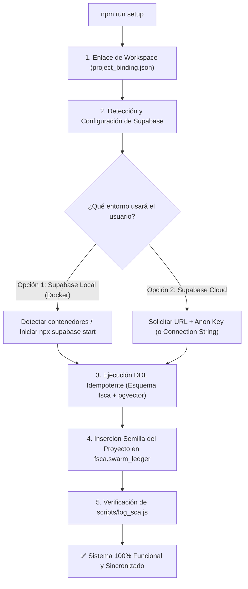

# Propuesta de Estandarización: Asistente de Inicialización Automática de Supabase para SCA Framework

> **Destino:** Repositorio Base del Framework SCA (`SCA Framework / Matrix`)  
> **Fecha:** 2026-10-09  
> **Objetivo:** Eliminar la fricción de incorporación (onboarding) y garantizar que todo proyecto nuevo registre automáticamente su telemetría y esquema en Supabase (Local o Cloud).

---

## 1. Diagnóstico del Problema Actual

En la versión actual del framework:
1. `npm install` solo descarga paquetes JavaScript (`node_modules`), pero no prepara la infraestructura de base de datos.
2. Si el usuario arranca `sca-studio` sin configuración previa:
   - Falla por ausencia de `AI_CONTEXT/project_binding.json` (`Error: Workspace sin project_binding.json`).
   - El dashboard y el grafo DAG intentan consultar el esquema `fsca` en Supabase y lanzan errores `503` / `409` si las tablas no existen o si el proyecto no tiene registros iniciales.
3. El protocolo `swarm_router_es` exige invocar `node scripts/log_sca.js ...`, pero si el script no viene incluido en el proyecto base, la persistencia temprana falla silenciosamente.

---

## 2. Arquitectura de Solución Propuesta

Implementar un comando unificado:
```bash
npm run setup
```
(O como paso guiado complementario tras `npm install`).



---

## 3. Componentes a Incorporar en el Proyecto Base

### A. Modificación en `package.json`
Agregar scripts dedicados para setup e inicialización:
```json
{
  "scripts": {
    "setup": "node scripts/setup_sca.js",
    "postinstall": "node scripts/check_setup.js"
  }
}
```

---

### B. Script de Inicialización: `scripts/setup_sca.js`
Este script interactivo y desatendido:
1. Lee o solicita el nombre del proyecto y genera `AI_CONTEXT/project_binding.json`:
   ```json
   {
     "project_name": "NombreDelProyecto"
   }
   ```
2. Detecta el archivo `.env.local` existente. Si no existe o contiene valores por defecto:
   - Ofrece elegir entre **Supabase Local (Docker)** o **Supabase Cloud**.
   - Para Cloud: Solicita la `NEXT_PUBLIC_SUPABASE_URL` y `NEXT_PUBLIC_SUPABASE_ANON_KEY` y escribe el archivo `.env.local`.
3. Aplica de forma **idempotente** el script DDL (`supabase/migrations/fsca_schema.sql`):
   - Crea el esquema `fsca`.
   - Habilita la extensión `vector` en `public`.
   - Crea tablas `fsca.swarm_ledger`, `fsca.metrics_log`, `fsca.knowledge_base` y sus índices `ivfflat`.
   - Aplica políticas RLS permisivas para el entorno de trabajo.
4. Inserta el primer registro en `fsca.swarm_ledger` para dar de alta el proyecto:
   ```sql
   INSERT INTO fsca.swarm_ledger (project_name, sprint_name, node_id, task_desc, status)
   VALUES ('NombreDelProyecto', 'Sprint 0 - Onboarding', 'N0', 'Inicialización del proyecto y SCA Matrix', '✅ Hecho')
   ON CONFLICT (project_name, sprint_name, node_id) DO NOTHING;
   ```
5. Si no se cuenta con conexión directa a la base de datos (solo API pública sin Service Key), genera automáticamente un archivo `supabase_setup_manual.sql` y le muestra al usuario el enlace directo al SQL Editor de Supabase:
   > *"Copia este contenido y haz clic en 'Run' en tu panel de Supabase: https://supabase.com/dashboard/project/_/sql"*

---

### C. Script Unificado de Telemetría: `scripts/log_sca.js`
Incorporar el script estándar que consumen `swarm_router_es` y `sca_compliance`:
- Soporta `--type ledger`:
  ```bash
  node scripts/log_sca.js --type ledger --project_name "..." --sprint_name "..." --node_id "N1" --task_desc "..." --status "⏳ Pendiente"
  ```
- Soporta `--type metric`:
  ```bash
  node scripts/log_sca.js --type metric --project_name "..." --main_task "..." --tokens_without_sca 50000 --tokens_with_sca 12000 ...
  ```
- Utiliza la configuración de `.env.local` y el `project_binding.json` para validar antes de enviar datos al backend de Supabase.

---

### D. Migración DDL Oficial: `supabase/migrations/001_fsca_core.sql`
Centralizar la DDL en un archivo de migración oficial versionado (reemplazando archivos temporales o snippets sueltos):
- Creación de esquema `fsca`.
- Tablas de ledger, métricas y base de conocimiento.
- Funciones RPC (`fsca.match_knowledge`).
- Políticas RLS y grants para roles `anon` y `authenticated`.

---

## 4. Guía para el Desarrollador (README.md del Framework)

Se recomienda actualizar el `README.md` del repositorio base con una sección de **Inicio Rápido (3 pasos)**:

```markdown
### 🚀 Inicio Rápido

1. Clonar el repositorio e instalar dependencias:
   ```bash
   git clone <repo-url>
   cd <repo>
   npm install
   ```

2. Ejecutar el asistente de configuración de base de datos:
   ```bash
   npm run setup
   ```
   *El asistente te permitirá vincular tu proyecto a Supabase Local (Docker) o Supabase Cloud en 1 minuto.*

3. Iniciar el monitor SCA Studio:
   ```bash
   npm run dev
   ```
```

---

## 5. Beneficios para el Ecosistema SCA

1. **Cero configuraciones a ciegas:** El desarrollador no necesita descifrar errores de tablas faltantes ni configurar esquemas a mano.
2. **Compatibilidad Híbrida:** Funciona tanto para quienes usan Docker local como para desarrolladores que trabajan 100% en la nube con la capa gratuita de Supabase.
3. **Consistencia Swarm:** Garantiza que el comando `scripts/log_sca.js` y el archivo `project_binding.json` estén siempre disponibles para los agentes y workflows autónomos.
